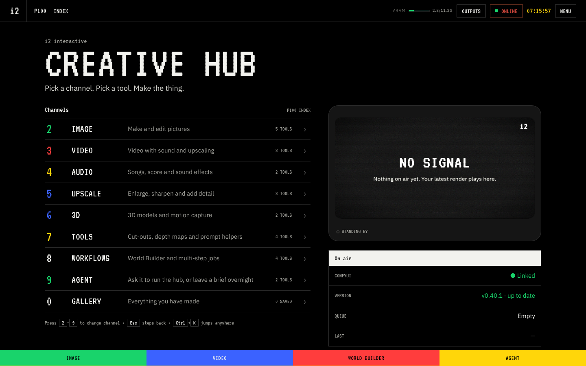
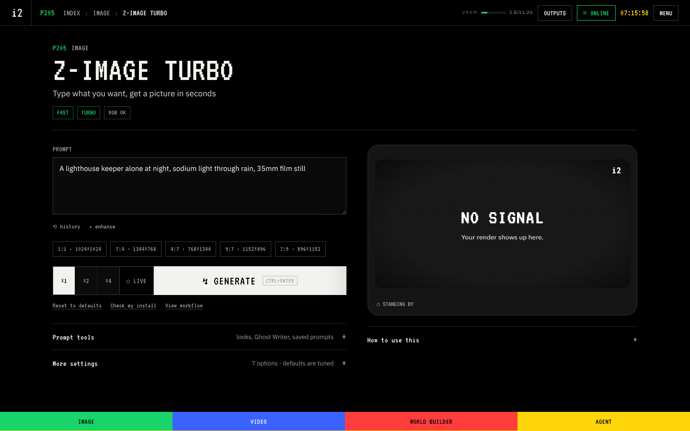
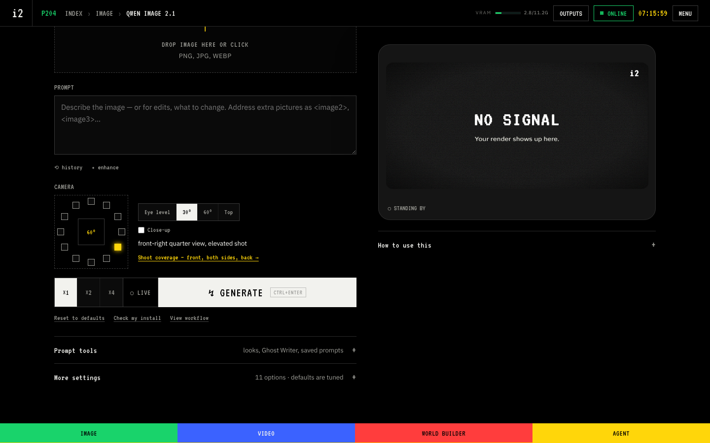
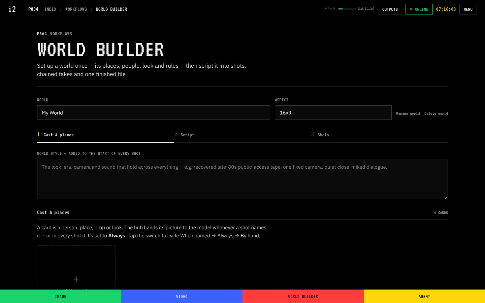
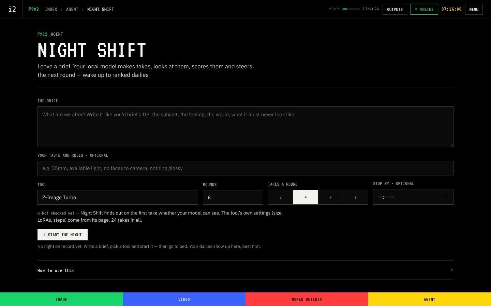
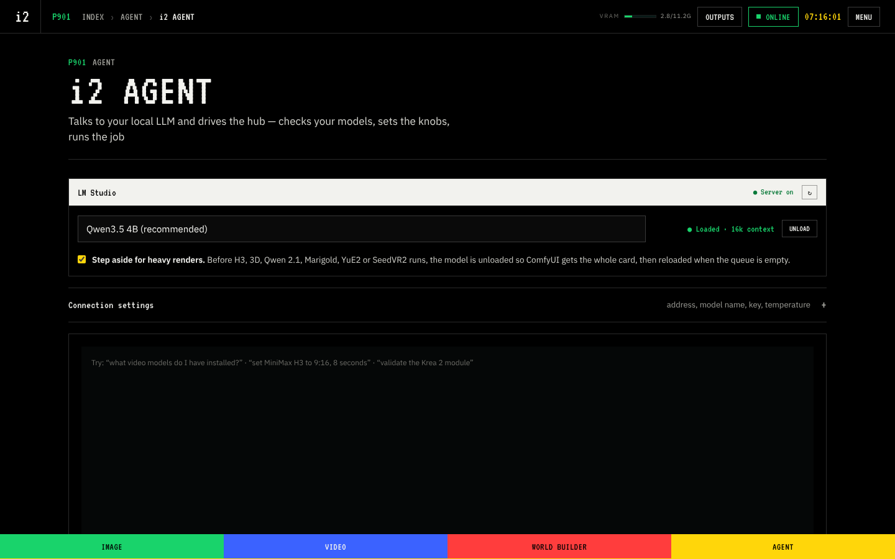
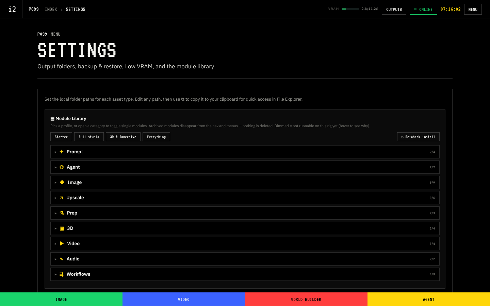

# i2 interactive Creative Hub

A single-file browser app for [ComfyUI](https://github.com/comfyanonymous/ComfyUI). Pick a channel, pick a tool, make the thing: images, video with sound, music, 3D, upscaling and finishing, with a local AI agent that can run it all for you.

No install, no account, no server of its own. It's one HTML file that talks to the ComfyUI already running on your machine.

## What's inside

- **Simple tool pages.** Each tool shows the few controls that matter; everything else sits under More settings with tuned defaults.
- **Live.** Image tools redraw as you type, on a locked seed, so you can see what each word does. Keep renders the full-quality version.
- **Live Canvas.** Paint, drop in a photo, or point your camera or screen at it, and the picture re-renders as you go.
- **World Builder.** Set up a world once (people, places, look, rules), break a script into shots, render chained video takes with sound, assemble one file, or export the timeline as XML for Premiere or Resolve.
- **Night Shift.** Leave a brief before bed. Your local LLM writes prompts, renders takes, looks at them, scores them against the brief and steers the next round. You wake up to ranked dailies.
- **i2 Agent.** Talk to a local LLM (LM Studio) and it checks your models, sets the knobs and runs the job.
- **Template Import.** ComfyUI's own template library, inside the hub. Pick a template, see which model files you're missing, and turn it into a hub tool. New models usually land there on release day.
- **NVIDIA RTX video tools.** Instant upscale, denoise, deblur and SDR-to-HDR on your RTX card.
- **Built for 8GB cards.** Developed on an RTX 3070 Ti. Low VRAM mode, an out-of-memory rescue, and automatic fast drafts help on smaller cards.
- **Credits on every render.** Each output records the models, LoRAs and inputs that made it, with a one-click disclosure line.

## Quick start

1. Install or update [ComfyUI](https://github.com/comfyanonymous/ComfyUI) (0.40 or newer recommended).
2. Start ComfyUI with the `--enable-cors-header` flag. The hub can't connect without it.
3. Download `i2-creative-hub.html` from this repo and open it in Chrome or Edge.
4. Click **OFFLINE** at the top right, check the address (default `http://127.0.0.1:8188`) and link it.
5. Open any tool and press **Check my install**. It tells you exactly which models and node packs that tool needs and where each file goes.

The full walkthrough, including node packs, every model file and LM Studio setup, is in [docs/INSTALL.md](docs/INSTALL.md).

## Tools you see on first launch

The hub opens with a **Starter** lineup: one strong tool per job. Everything else is one click away in **Settings › Module Library** (presets: Starter, Full studio, 3D & Immersive, Everything).

| Channel | Tool | What it does |
| --- | --- | --- |
| Image | **Live Canvas** | Paint, drop in a photo, or point your camera or screen at it — the picture re-renders as you go, steered by your prompt |
| Image | **Qwen Image 2.1** | One model to make or edit pictures — native 2K, real typography, transparent backgrounds |
| Image | **Z-Image Turbo** | Type what you want, get a picture in seconds |
| Image | **Composition & Style** | Copies the layout of one image into a brand new one |
| Image | **Krea 2 Turbo** | High quality picture maker with style looks built in |
| Video | **MiniMax H3** | Video with sound built in — from text, a still, references, keyframes or a motion video |
| Video | **Video Upscale** | Makes a video bigger and cleaner, keeps the sound |
| Video | **RTX Video Finish** | Upscale, clean up and convert video to HDR on your NVIDIA card — keeps the sound |
| Audio | **Music** | Full songs with vocals — YuE2 for real song structure, ACE-Step for fast drafts |
| Audio | **Stable Audio 3** | Type a description, get music or sound effects |
| Upscale | **SeedVR2 Upscale** | One-step AI upscale that rebuilds real detail (INT8, low VRAM) |
| Upscale | **Creative Upscale** | Makes your picture bigger and invents extra detail as it grows |
| Upscale | **RTX Fast Upscale** | Instant upscale, denoise or deblur on your NVIDIA card |
| 3D | **3D Model** | A picture becomes a textured 3D model — or feed it a turnaround sheet for true sides and back |
| 3D | **Motion Capture** | Film a person, get an animated 3D body file plus an overlay video |
| Tools | **Image Maps** | Pull depth, surface normals, true color, pose or edges out of any picture |
| Tools | **Background Remover** | Erases the background and saves a transparent PNG |
| Tools | **Qwen3-VL Describe** | Show it a picture and it writes the prompt for you |
| Tools | **Prompt Lab** | Looks, Ghost Writer phrases, wildcards, saved prompts and script builders — your presets, in one place |
| Workflows | **Finish** | Color grade your picture with wheels and knobs like a colorist |
| Workflows | **Character Sheet** | One prompt becomes a consistent character from many angles |
| Workflows | **Template Import** | Turn any ComfyUI template or workflow into a hub tool — new models usually land in the library on release day |
| Workflows | **World Builder** | Set up a world once (places, people, look, rules), script it into shots, render chained video takes, and export the timeline to Premiere or Resolve |
| Agent | **i2 Agent** | Ask in plain words and your local LLM runs the hub for you |
| Agent | **Night Shift** | Leave a brief; your local LLM makes takes overnight, reviews them and steers the next round |

Also included, switched off by default

| Channel | Tool | What it does |
| --- | --- | --- |
| Image | **Mage Flow Turbo** | Four-step picture maker — quick and easy on VRAM |
| Image | **Mage Flow Edit** | Upload a photo, say what to change — four steps |
| Image | **Krea 2 Style Reference** | Give it a picture to copy the look from, then describe a new scene |
| Image | **Anima** | Makes anime style pictures from your words |
| Video | **Frame Interpolation** | Smooths choppy video or makes clean slow motion |
| Upscale | **Traditional Upscale** | Makes your picture bigger without changing anything |
| Upscale | **Sharpen Upscale** | Simple 4x enlarge with a sharpening model |
| Upscale | **Detail Refiner** | Gives your picture a quick second pass for crisper detail |
| 3D | **Action Stage** | Pose 3D characters and cameras, then hand the shot to image tools |
| 3D | **Gaussian Splats** | Turns a photo into a 3D scene you can fly around in |
| Tools | **Camera Angle** | Adds camera angles and lens looks to your prompt |
| Tools | **Face Swap** | Puts a face from one photo onto another |
| Tools | **Gemma 4 Vision** | A second vision helper that describes images in words |
| Workflows | **Stitch / Grid** | Combines your latest renders into one grid or strip |
| Workflows | **Asset Expander** | Takes one good image and spins out lots of matching variations |
| Workflows | **Prompt Blast** | Renders every saved prompt preset in one go |
| Workflows | **Pipeline** | Chain tools in a line so each step feeds the next |
| Workflows | **Node Canvas** | A board where you wire tools together any way you like |

## Screenshots

| | |
| --- | --- |
|  |  |
|  |  |
|  |  |

## Requirements

- **ComfyUI** 0.40 or newer recommended (0.37 is the minimum for Qwen Image 2.1; the front page tells you if a tool needs a newer ComfyUI).
- **An NVIDIA GPU.** 8GB works for most tools; 12GB or more is more comfortable for video. The RTX tools need an RTX card, and RTX frame generation needs a 40-series or newer.
- **32GB of system RAM** recommended for video and 3D.
- **Chrome or Edge.**
- **LM Studio** (optional) for the i2 Agent, Night Shift, prompt Enhance and Variations.

## Privacy

Everything runs on your machine. The hub has no accounts, no analytics and no server of its own. It only talks to:

- your ComfyUI (renders, model lists, uploads),
- your LM Studio, if you use the agent features,
- ComfyUI's public template list on GitHub, when you open the template library and your ComfyUI doesn't serve it,
- jsDelivr, to load the 3D viewer library when you open a 3D result.

Settings, your gallery and prompt history stay in your browser's local storage. Use **Settings › Backup & restore** to move them to another machine.

## Content filter

The hub has a built-in prompt filter. It blocks sexual content, sexual content involving minors and graphic violence before anything is sent to ComfyUI.

If other people use your ComfyUI, also install the optional [server-side guard](server-guard/README.md). It applies the same rules inside ComfyUI, to every job from any app.

## License

MIT. See [LICENSE](LICENSE). The embedded fonts (IBM Plex Sans, IBM Plex Mono and VT323) are under the SIL Open Font License; see [NOTICE.md](NOTICE.md).

Made by Ian Isom at [i2 interactive](https://i2interactive.com) in San Diego.

Version 1.21.1.
